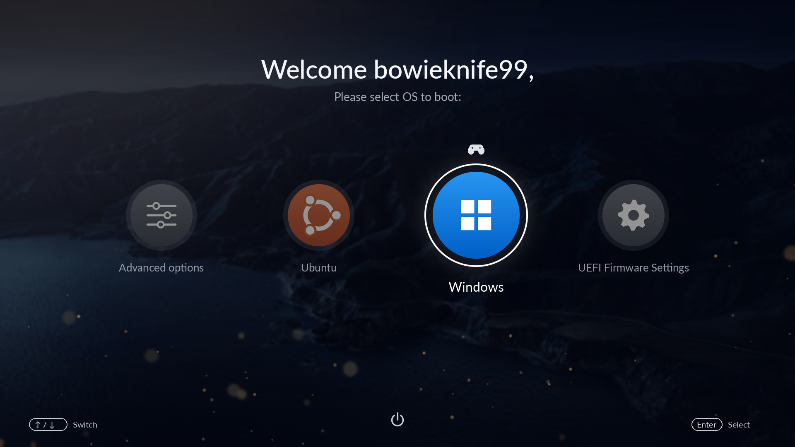
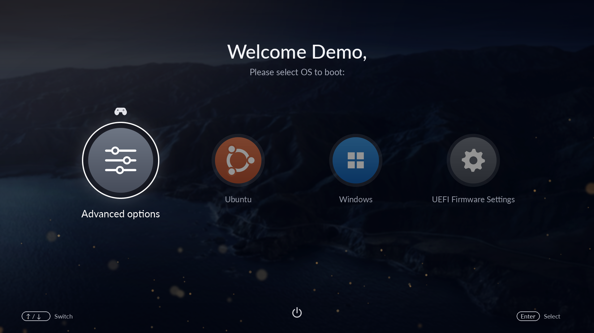

# grub-ps5-theme

A PlayStation 5 "who's using this controller?" style boot menu for GRUB, for dual-boot PCs.
A horizontal row of big round badges (Advanced options, Ubuntu, Windows, UEFI Firmware Settings),
the selected one larger with a white ring, over a dark wallpaper with soft golden bokeh.
It greets you with **"Welcome <your name>,"**.

| Windows selected | Advanced options selected |
|---|---|
|  |  |

> Status: tested on **Ubuntu 26.10, UEFI, GRUB 2.14** at 1920x1080. It works there, but it has not been
> run on other setups. Read "How it works" and "Safety" before installing, and have a way to boot
> (the firmware boot menu, usually F12) in case you need to undo it.

## Install

```bash
sudo apt install python3-pil fonts-lato fonts-dejavu-core grub-common
git clone https://github.com/jazzkentjana/grub-ps5-theme.git
cd grub-ps5-theme
sudo ./install.sh
```

Options:

| Option | What it does |
|---|---|
| `--name NAME` | Name shown in "Welcome NAME,". Default: your Linux username. |
| `--wallpaper FILE` | Use your own wallpaper (any size; it is cropped to 16:9 and darkened). |
| `--timeout N` | Seconds before the default entry boots (leaves your current value if omitted). |
| `--no-reorder` | Only install the theme; do not reorder the menu (see below). |

The installer backs up your GRUB settings first, rebuilds the menu, checks the result (theme found,
`grub.cfg` syntax valid) and **restores everything by itself if a check fails**.

Restart to see it. **Navigate with the Up/Down arrow keys**; Enter boots the highlighted entry.

## Uninstall

```bash
sudo ./uninstall.sh
```

This restores the GRUB settings saved before the first install (kept in `/var/lib/grub-ps5-theme`).

## How it works

GRUB's theme system can only draw a *vertical* list. To get a horizontal row, this theme uses the
"full-screen icon" trick: the menu is as tall as the whole screen, so only one entry is visible at a
time, and each entry's icon is a complete 1920x1080 picture in which *that* entry is the selected one.
Pressing Up/Down swaps to the next picture. `generator/build_theme.py` draws those pictures.

Because GRUB picks an entry's picture by its **class** (`ubuntu`, `windows`, ...), three small scripts
are installed in `/etc/grub.d`:

* `09_ps5_menu_order` runs Ubuntu's own `10_linux`, puts the "Advanced options" submenu **before** the
  main Ubuntu entry (so the row order matches the Up/Down order), gives it the class `advanced`, and adds
  "Loading Linux ..." lines to the Ubuntu entry so the boot console is not an empty black box.
  It switches `10_linux` off (not executable) so it does not run twice, and re-applies that on every
  `update-grub`, so kernel and package updates keep working.
* `29_ps5_efi_class` / `39_ps5_class_reset` give "UEFI Firmware Settings" the class `efi`.

## Customising

```bash
python3 generator/build_theme.py --help
```

You can change the name, the wallpaper and the list of entries (`--entries "advanced:Advanced options,ubuntu:Ubuntu,windows:Windows,efi:UEFI Firmware Settings"`),
and write a preview image with `--preview-png`. Preview a theme without rebooting using
[`grub2-theme-preview`](https://github.com/hartwork/grub2-theme-preview) (`pipx install grub2-theme-preview`).

## Limitations (please read)

* **No animation.** GRUB cannot animate: moving between entries is an instant swap of pictures.
* **Up/Down only.** The real menu underneath is still a vertical list. In GRUB the Right arrow may act like
  Enter, so do not use Left/Right.
* **The circle order is baked into the pictures.** If you change `--entries`, list them in the same order as the real GRUB menu (top to bottom).
* **Every entry needs a matching picture.** Entries with no class (or a class the theme has no picture for,
  such as another Linux distribution) show a black screen. The defaults cover Advanced options, Ubuntu,
  Windows and UEFI Firmware Settings; add others with `--entries`. Entries without any class, such as
  "Firmware update", will show black until you give them one.
* **The black console box.** When an entry starts, GRUB shows its text console. Its inside is always opaque
  black; this theme frames it with a glass border and the Ubuntu entry prints loading messages into it.
* **Duplicate Windows entries.** If two disks both hold a copy of the Windows boot files, os-prober lists
  Windows twice. Both boot Windows.
* Tested only with Ubuntu + Windows, UEFI, 1920x1080.

## Safety

* The installer only edits `/etc/default/grub`, adds three files to `/etc/grub.d`, adds `/boot/grub/themes/ps5`,
  and switches the executable bit of `/etc/grub.d/10_linux` off. `uninstall.sh` reverts all of it.
* If the menu ever fails to show, press **F12** (or your firmware's boot-menu key) at power-on and choose the OS
  directly, then run `sudo ./uninstall.sh`.
* Use at your own risk; see the license.

## Credits and licenses

* Code and generated artwork: [MIT](LICENSE). Third-party material and trademarks: see [NOTICE](NOTICE).
* `assets/wallpaper-default.jpg` is based on a macOS Big Sur wallpaper and is the property of Apple Inc.;
  it is **not** covered by the MIT license and is included only as a default. Replace it with your own image
  (`--wallpaper`) or remove it if you redistribute this project.
* Fonts (Lato, DejaVu) are installed from your system packages and converted by `grub-mkfont`;
  both are under free licenses (SIL OFL / Bitstream Vera-DejaVu).
* "Ubuntu" and "Windows" and their logos are trademarks of their respective owners; the badges are simple
  stylised drawings used only to identify the entries.
* The full-screen icon technique is also used by other GRUB themes, for example the Matrix-Morpheus theme.
